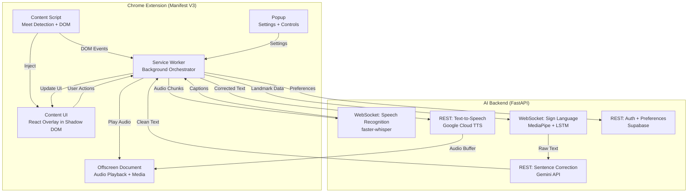
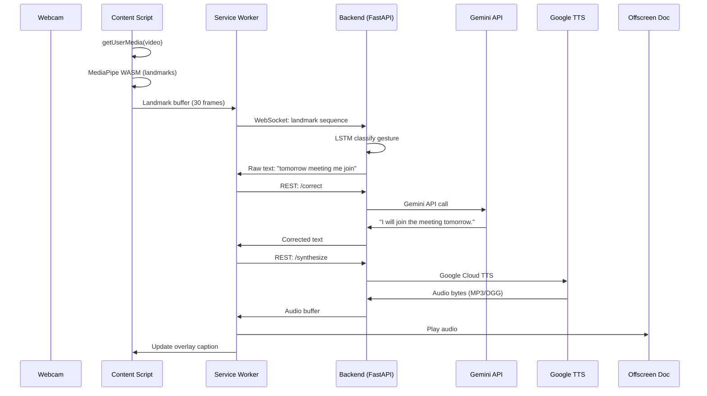
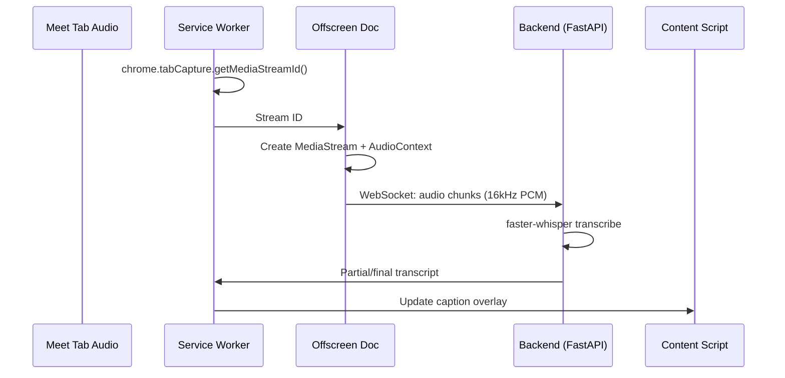
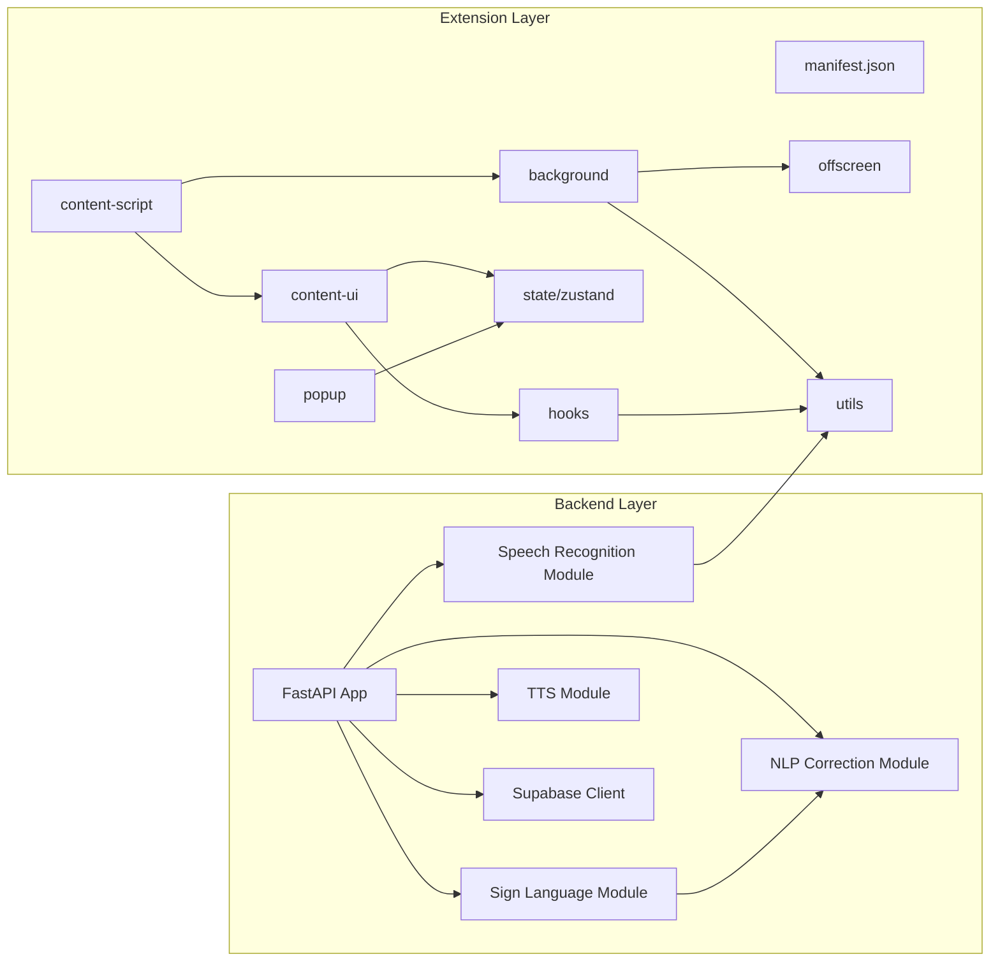
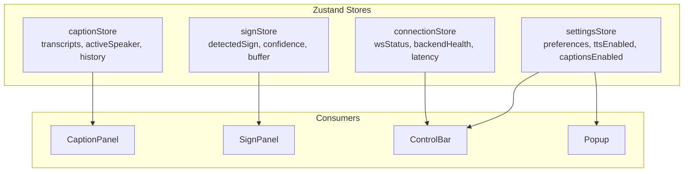

# TruVision — Phase 1: Architecture & Planning

Real-time accessibility Chrome extension for Google Meet enabling bidirectional communication between speech-impaired ISL users and hearing participants.

---

## ✅ All Infrastructure Decisions — LOCKED

> [!NOTE]
> **All open questions have been resolved.** The following decisions are finalized for MVP and non-negotiable unless a major technical blocker appears.

| Decision | Choice | Status |
|----------|--------|--------|
| ML Framework | **TensorFlow 2.x / Keras** | ✅ Locked |
| ISL Dataset | **INCLUDE (Kaggle, pre-extracted MediaPipe landmarks)** | ✅ Locked |
| TTS Delivery | **Client-side browser playback via Offscreen Document** | ✅ Locked |
| Database & Auth | **Managed Supabase Cloud** (Google OAuth + email/password) | ✅ Locked |
| API Key Security | **All keys proxied through FastAPI backend — never in extension** | ✅ Locked |
| Speech Recognition | **faster-whisper via FastAPI WebSocket** | ✅ Locked |
| NLP Correction | **Gemini API (sentence cleanup only, not conversational)** | ✅ Locked |

---

## 1. System Architecture

### High-Level Architecture



### Extension Context Model

| Context | Role | Can Access DOM? | Persistent? |
|---------|------|----------------|-------------|
| **Content Script** | Injected into `meet.google.com`. Detects meeting state, injects overlay root | Yes (page DOM) | Per-tab |
| **Content UI** | React app in Shadow DOM. Renders overlay, captions, controls | Yes (shadow DOM) | Per-tab |
| **Service Worker** | Central orchestrator. Routes messages, manages WebSocket connections | No | Ephemeral |
| **Offscreen Document** | Audio playback via Web Audio API. Handles TTS audio output | Yes (own DOM) | Created on demand |
| **Popup** | Settings panel. Enable/disable features, configure preferences | Yes (own DOM) | On click |

---

## 2. Data Flow Diagrams

### Flow 1: ISL → Text → Speech



### Flow 2: Speech → Captions



---

## 3. Component Dependency Graph



---

## 4. Repository Structure

```text
truvision/
├── README.md
├── .gitignore
├── .prettierrc
├── .eslintrc.cjs
├── commitlint.config.cjs
├── .husky/
│   ├── pre-commit
│   └── commit-msg
│
├── extension/                          # Chrome Extension (React + Vite + TS)
│   ├── package.json
│   ├── tsconfig.json
│   ├── vite.config.ts
│   ├── tailwind.config.ts
│   ├── postcss.config.cjs
│   ├── .env.example
│   │
│   ├── public/
│   │   ├── manifest.json              # Manifest V3
│   │   └── icons/
│   │       ├── icon-16.png
│   │       ├── icon-48.png
│   │       └── icon-128.png
│   │
│   └── src/
│       ├── background/
│       │   ├── index.ts                # Service worker entry
│       │   ├── message-router.ts       # Message handler registry
│       │   ├── websocket-manager.ts    # WS connection pool
│       │   └── offscreen-manager.ts    # Offscreen doc lifecycle
│       │
│       ├── content-script/
│       │   ├── index.ts                # Content script entry
│       │   ├── meet-detector.ts        # Detect active Meet session
│       │   ├── overlay-injector.ts     # Inject Shadow DOM root
│       │   └── webcam-capture.ts       # getUserMedia + MediaPipe
│       │
│       ├── content-ui/
│       │   ├── index.tsx               # React root in Shadow DOM
│       │   ├── App.tsx
│       │   ├── components/
│       │   │   ├── CaptionPanel.tsx
│       │   │   ├── SignPanel.tsx
│       │   │   ├── ControlBar.tsx
│       │   │   └── StatusIndicator.tsx
│       │   └── styles/
│       │       └── overlay.css
│       │
│       ├── popup/
│       │   ├── index.html
│       │   ├── index.tsx
│       │   ├── Popup.tsx
│       │   └── styles/
│       │       └── popup.css
│       │
│       ├── offscreen/
│       │   ├── index.html
│       │   ├── index.ts                # Audio playback + tab capture
│       │   └── audio-player.ts         # Web Audio API wrapper
│       │
│       ├── state/
│       │   ├── index.ts
│       │   ├── caption-store.ts        # Zustand: captions state
│       │   ├── sign-store.ts           # Zustand: sign recognition state
│       │   ├── settings-store.ts       # Zustand: user preferences
│       │   └── connection-store.ts     # Zustand: WS connection state
│       │
│       ├── hooks/
│       │   ├── useMediaPipe.ts
│       │   ├── useWebSocket.ts
│       │   ├── useMeetSession.ts
│       │   └── useAccessibility.ts
│       │
│       ├── utils/
│       │   ├── constants.ts
│       │   ├── message-types.ts        # Typed message contracts
│       │   ├── permissions.ts
│       │   └── logger.ts
│       │
│       └── types/
│           ├── index.ts
│           ├── landmarks.ts
│           ├── captions.ts
│           └── messages.ts
│
├── backend/                            # FastAPI Backend
│   ├── pyproject.toml
│   ├── requirements.txt
│   ├── Dockerfile
│   ├── .env.example
│   │
│   ├── app/
│   │   ├── __init__.py
│   │   ├── main.py                     # FastAPI app entry
│   │   ├── config.py                   # Settings via pydantic
│   │   │
│   │   ├── api/
│   │   │   ├── __init__.py
│   │   │   ├── router.py              # API router aggregator
│   │   │   ├── ws_speech.py           # WebSocket: speech recognition
│   │   │   ├── ws_sign.py             # WebSocket: sign recognition
│   │   │   ├── rest_correction.py     # REST: Gemini sentence fix
│   │   │   ├── rest_tts.py            # REST: Google TTS
│   │   │   └── rest_preferences.py    # REST: user preferences
│   │   │
│   │   ├── services/
│   │   │   ├── __init__.py
│   │   │   ├── speech_service.py      # faster-whisper wrapper
│   │   │   ├── sign_service.py        # LSTM inference
│   │   │   ├── correction_service.py  # Gemini API client
│   │   │   ├── tts_service.py         # Google Cloud TTS client
│   │   │   └── auth_service.py        # Supabase auth
│   │   │
│   │   ├── models/
│   │   │   ├── __init__.py
│   │   │   ├── schemas.py             # Pydantic request/response
│   │   │   └── db_models.py           # SQLAlchemy/Supabase models
│   │   │
│   │   └── core/
│   │       ├── __init__.py
│   │       ├── dependencies.py        # FastAPI dependencies
│   │       ├── middleware.py           # CORS, logging
│   │       └── exceptions.py          # Custom error handlers
│   │
│   └── ml/
│       ├── __init__.py
│       ├── sign_model/
│       │   ├── model.py               # LSTM architecture (TensorFlow/Keras)
│       │   ├── train.py               # Training script
│       │   ├── inference.py           # Real-time inference
│       │   └── weights/               # Saved model weights (.h5 / SavedModel)
│       │       └── .gitkeep
│       │
│       └── data/
│           ├── download_dataset.py    # Script to download INCLUDE from Kaggle
│           ├── preprocessor.py        # Landmark normalization + augmentation
│           ├── label_map.json         # Sign label → index mapping
│           └── dataset/
│               └── .gitkeep
│
└── docs/
    ├── architecture.md
    ├── api-contracts.md
    └── setup.md
```

---

## 5. API Contracts

### WebSocket: Speech Recognition

```
Endpoint: ws://{host}/ws/speech
Direction: Client → Server (audio chunks), Server → Client (transcripts)
```

| Direction | Payload |
|-----------|---------|
| Client → Server | Binary: PCM audio (16kHz, 16-bit, mono) |
| Server → Client | `{ "type": "partial" \| "final", "text": string, "timestamp": number }` |

### WebSocket: Sign Language Recognition

```
Endpoint: ws://{host}/ws/sign
Direction: Client → Server (landmarks), Server → Client (predictions)
```

| Direction | Payload |
|-----------|---------|
| Client → Server | `{ "landmarks": float[][], "frame_count": number, "timestamp": number }` |
| Server → Client | `{ "type": "prediction", "sign": string, "confidence": number, "timestamp": number }` |

### REST: Sentence Correction

```
POST /api/v1/correct
```

**Request:**
```json
{
  "text": "tomorrow meeting me join",
  "context": ["hello", "need help"]
}
```

**Response:**
```json
{
  "original": "tomorrow meeting me join",
  "corrected": "I will join the meeting tomorrow.",
  "latency_ms": 142
}
```

### REST: Text-to-Speech

```
POST /api/v1/synthesize
```

**Request:**
```json
{
  "text": "I will join the meeting tomorrow.",
  "voice": "en-IN-Wavenet-B",
  "speed": 1.0
}
```

**Response:**
```json
{
  "audio_base64": "<base64-encoded-audio>",
  "format": "mp3",
  "duration_ms": 2100
}
```

### REST: User Preferences

```
GET  /api/v1/preferences
PUT  /api/v1/preferences
```

**Schema:**
```json
{
  "tts_enabled": true,
  "tts_voice": "en-IN-Wavenet-B",
  "tts_speed": 1.0,
  "captions_enabled": true,
  "caption_font_size": "medium",
  "sign_detection_enabled": true,
  "overlay_position": "bottom-right",
  "overlay_opacity": 0.9
}
```

---

## 6. State Management Architecture

Using **Zustand** with the following store topology:



**State sync strategy**: Extension contexts (content script, popup, service worker) communicate via `chrome.runtime.sendMessage`. Zustand stores live in the content-ui context. The service worker pushes state updates to content scripts via message passing.

---

## 7. Key Architecture Decisions

| # | Decision | Rationale | Alternative Considered |
|---|----------|-----------|----------------------|
| 1 | **Shadow DOM for overlay** | Isolates extension CSS from Google Meet's styles. Prevents style conflicts. | iframe — heavier, cross-origin issues |
| 2 | **MediaPipe WASM in content script** | Runs landmark detection client-side, reducing latency and bandwidth. Only sends compact landmark data to backend. | Server-side video processing — too much bandwidth, 200ms+ latency |
| 3 | **Offscreen document for audio** | Only MV3-compliant way to play audio and use Web Audio API from extension | Background page (MV2 only) |
| 4 | **WebSocket for streaming data** | Persistent connection for real-time audio/landmark streaming. Lower overhead than repeated HTTP | REST polling — too much latency |
| 5 | **Backend-side LSTM inference** | Keeps extension bundle small. Allows model updates without extension republish | Client-side ONNX — large bundle, inconsistent perf |
| 6 | **Client-side MediaPipe** | MediaPipe WASM is optimized for browser. Sends only 63 floats/frame vs raw video frames | Server-side MediaPipe — bandwidth heavy |
| 7 | **Gemini Flash for correction** | Fastest Gemini model, low cost, sufficient for grammar correction | Local NLP model — less accurate, larger footprint |

---

## 8. Tradeoffs

| Tradeoff | Chose | Over | Why |
|----------|-------|------|-----|
| Latency vs Accuracy | Latency | Higher accuracy models | MVP targets <500ms. Use `whisper-base` and `gemini-flash` |
| Bundle size vs Features | Small bundle | Client-side ML | Keep extension under 5MB. Offload ML to backend |
| Privacy vs Functionality | Privacy | Server-side video | Never send raw video. Only send landmark coordinates |
| Simplicity vs Scalability | Simplicity | Microservices | Monolithic FastAPI for MVP. Split later if needed |
| Real-time vs Batch | Real-time | Batch processing | WebSocket streaming over REST batching for <500ms target |

---

## 9. Risks & Mitigations

### Risk 1 — TTS Audio Delivery

**Risk**: Cannot inject TTS audio into Google Meet's outgoing audio stream due to Chrome security model.

**Mitigation (MVP)**:
- Play synthesized speech audio locally in the browser/tab context using the Offscreen Document.
- Display a helper message in the UI overlay: "Enable tab audio sharing for synthesized speech" to allow other participants to hear it natively if desired.
- Explicitly defer virtual microphone injection, OS-level audio routing, and WebRTC spoofing to post-MVP phases.

### Risk 2 — MediaPipe WASM Performance

**Risk**: Running MediaPipe in content script may impact Google Meet's performance.

**Mitigation**: Throttle to 10 FPS for landmark extraction. Use `requestAnimationFrame` with frame skipping. Profile and optimize.

### Risk 3 — ISL Recognition Accuracy

**Risk**: Limited training data or complex patterns may result in low accuracy.

**Mitigation**: Use the pre-extracted INCLUDE dataset (263 signs, 4,287 videos) on Kaggle. Filter it down to 50–100 high-confidence word-level signs for the MVP model. Apply data augmentation (coordinate jittering, mirroring, sequence padding) during training of the TensorFlow/Keras LSTM model. Set the prediction confidence threshold at 70% to avoid false outputs.

### Risk 4 — Service Worker Lifecycle

**Risk**: MV3 service workers are ephemeral — WebSocket connections will drop when worker sleeps.

**Mitigation**: Implement reconnection logic. Use `chrome.alarms` keepalive. Store connection state in `chrome.storage.local`.

### Risk 5 — Google Meet DOM Changes

**Risk**: Google Meet's DOM structure may change, breaking content script selectors.

**Mitigation**: Use resilient selectors (data attributes, aria labels). Implement MutationObserver. Version-check Meet UI.

---

## 10. Manifest V3 Configuration

```json
{
  "manifest_version": 3,
  "name": "TruVision",
  "version": "0.1.0",
  "description": "Real-time ISL accessibility for Google Meet",
  "permissions": [
    "activeTab",
    "tabCapture",
    "offscreen",
    "storage",
    "scripting"
  ],
  "host_permissions": [
    "*://meet.google.com/*"
  ],
  "background": {
    "service_worker": "src/background/index.ts",
    "type": "module"
  },
  "content_scripts": [{
    "matches": ["*://meet.google.com/*"],
    "js": ["src/content-script/index.ts"],
    "css": [],
    "run_at": "document_idle"
  }],
  "action": {
    "default_popup": "src/popup/index.html",
    "default_icon": {
      "16": "icons/icon-16.png",
      "48": "icons/icon-48.png",
      "128": "icons/icon-128.png"
    }
  },
  "icons": {
    "16": "icons/icon-16.png",
    "48": "icons/icon-48.png",
    "128": "icons/icon-128.png"
  }
}
```

---

## 11. Performance Budget

| Metric | Target | Measurement |
|--------|--------|-------------|
| Extension bundle size | < 5 MB | Vite build output |
| Overlay render FPS | ≥ 30 FPS | Chrome DevTools Performance |
| ISL detection latency | < 300ms | Landmark extraction + WS + inference |
| Speech-to-text latency | < 500ms | Audio chunk + Whisper processing |
| Sentence correction latency | < 200ms | Gemini API round-trip |
| TTS synthesis latency | < 300ms | Google TTS API round-trip |
| End-to-end ISL→Speech | < 1000ms | Full pipeline |
| Memory usage (extension) | < 150 MB | Chrome Task Manager |

---

## Verification Plan

### Automated Tests
- **Extension**: `vitest` for unit tests on stores, hooks, utilities
- **Backend**: `pytest` + `pytest-asyncio` for API endpoint testing
- **ML**: Accuracy benchmarks on held-out test set (target 85%+)
- **Integration**: Puppeteer E2E tests loading extension into Chrome

### Manual Verification
- Load extension in Chrome, navigate to `meet.google.com`
- Verify overlay renders correctly without breaking Meet UI
- Test webcam capture and landmark extraction at 10+ FPS
- Test speech recognition with live audio
- Verify TTS playback through offscreen document
- Test on Windows 10/11 with Chrome 120+

---

## 12. ISL Dataset Strategy

We will use **open-source datasets** for training the LSTM gesture recognition model. No self-collection needed for MVP.

### Primary Dataset: INCLUDE (via Kaggle)

| Property | Details |
|----------|--------|
| **Name** | Indian Sign Language MediaPipe Holistic Landmarks |
| **Source** | [Kaggle: isl-mediapipe-holistic-landmarks-generation](https://www.kaggle.com/datasets/swaptr/isl-mediapipe-holistic-landmarks-generation) |
| **Origin** | AI4Bharat INCLUDE corpus |
| **Signs** | 263 word-level sign classes |
| **Videos** | 4,284 video takes |
| **Format** | Pre-extracted MediaPipe Holistic landmarks in **Parquet** format |
| **Landmarks** | 553 per frame (478 face + 33 pose + 21 per hand × 2) |
| **Why this?** | Landmarks are **already extracted** — no need to run MediaPipe on raw video. Directly usable for LSTM training. Follows Google GISLR competition format. |

### Supplementary Datasets

| Dataset | Signs | Format | Use Case |
|---------|-------|--------|----------|
| [INCLUDE (raw landmarks)](https://www.kaggle.com/datasets/daskoushik/include) | 263 | MediaPipe landmarks | Alternative extraction of same corpus |
| [ISL-CSLTR](https://www.kaggle.com/datasets/karthiksaxena/islcsltr-indian-sign-language-dataset) | 100 sentences, 700 videos | Video + annotations | Future sentence-level recognition |
| [iSign Benchmark](https://exploration-lab.github.io/iSign/) | 118k+ video-sentence pairs | Video + text | Future advanced translation |
| [ISL Hand Landmarks](https://www.kaggle.com/datasets/prakharrathi25/indian-sign-language-hand-landmarks-dataset) | A–Z alphabets | Hand landmarks CSV | Fingerspelling support |

### MVP Approach

1. **Download** the INCLUDE Parquet dataset from Kaggle (automated via `download_dataset.py`)
2. **Filter** to our target 50–100 MVP signs (e.g., hello, yes, no, thank you, need help, water, meeting, wait, stop, sorry)
3. **Preprocess**: Normalize landmarks relative to wrist position, pad/truncate sequences to 30 frames
4. **Train**: LSTM model using TensorFlow/Keras on the filtered subset
5. **Evaluate**: Hold out 20% for validation, target 85%+ accuracy on MVP signs
6. **Augment**: Apply frame jittering, mirroring, and slight coordinate noise for robustness

### ML Tech Stack (Confirmed)

| Component | Technology |
|-----------|------------|
| Framework | **TensorFlow 2.x / Keras** |
| Model | Stacked LSTM (2–3 layers) + Dense classifier |
| Input | MediaPipe landmark sequences (30 frames × 126 features per frame — hands + pose) |
| Output | Softmax over 50–100 sign classes |
| Training | GPU-accelerated, ~30 min on Colab/local GPU |
| Inference | TensorFlow SavedModel served via FastAPI |
| Landmark extraction | MediaPipe Holistic (WASM in browser, Python for training) |

---

## 13. Database Schema & Privacy Controls (Supabase)

We will use a managed **Supabase Cloud** instance for handling Google OAuth, email/password login, user settings persistence, and lightweight anonymized usage metrics.

### Database Tables (PostgreSQL)

#### 1. `user_preferences`
Stores user-specific extension configuration.

```sql
create table public.user_preferences (
  user_id uuid references auth.users(id) on delete cascade primary key,
  updated_at timestamp with time zone default timezone('utc'::text, now()) not null,
  caption_size text default 'medium'::text not null,
  voice_type text default 'en-IN-Wavenet-B'::text not null,
  theme text default 'dark'::text not null,
  preferred_language text default 'en-US'::text not null,
  accessibility_enabled boolean default true not null
);

-- Enable Row Level Security
alter table public.user_preferences enable row level security;

-- Policies
create policy "Users can view their own preferences"
  on public.user_preferences for select
  using (auth.uid() = user_id);

create policy "Users can update their own preferences"
  on public.user_preferences for update
  using (auth.uid() = user_id);

create policy "Users can insert their own preferences"
  on public.user_preferences for insert
  with check (auth.uid() = user_id);
```

#### 2. `analytics_events`
Stores aggregated, non-identifiable usage statistics for service metrics and performance profiling.

```sql
create table public.analytics_events (
  id uuid default gen_random_uuid() primary key,
  created_at timestamp with time zone default timezone('utc'::text, now()) not null,
  session_duration_seconds integer not null,
  signs_detected_count integer default 0 not null,
  captions_characters_count integer default 0 not null,
  average_latency_ms integer not null
);

-- Enable Row Level Security (Write-only for authenticated extension sessions)
alter table public.analytics_events enable row level security;

create policy "Authenticated users can insert analytics"
  on public.analytics_events for insert
  to authenticated
  with check (true);
```

### Strict Privacy Rules (Enforced by Design)

> [!CAUTION]
> **Strict Privacy Safeguards**: Under no circumstances will any audio, video, landmark data, or chat transcription text be saved to the database or logged on the server.
> - **Webcam/Video**: Processed entirely local-to-browser via MediaPipe WASM. No video frames are transmitted to the backend.
> - **Landmarks**: Streamed live over WebSocket for inference only. Discarded immediately after classification.
> - **Audio Feed**: Streamed live over WebSocket for transcription. Audio chunks are processed in-memory by `faster-whisper` and immediately freed. No audio recordings are saved.
> - **Transcripts**: Sent to client over WebSocket and corrected via Gemini. Only displayed on the user's overlay and not logged or stored.

---

## Next Steps (Phase 2 Preview)

After approval, Phase 2 will:
1. Initialize monorepo with the folder structure above
2. Set up Vite + React + TypeScript for the extension
3. Configure TailwindCSS
4. Set up FastAPI backend scaffold with TensorFlow dependencies
5. Configure linting (ESLint), formatting (Prettier), and commit hooks (Husky + commitlint)
6. Create `.env.example` files for all services
7. Add Kaggle dataset download script for INCLUDE
8. Verify the extension loads in Chrome with a blank popup
